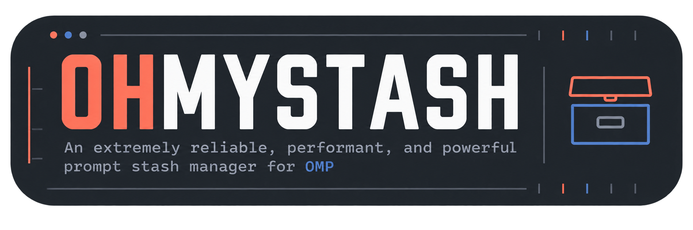
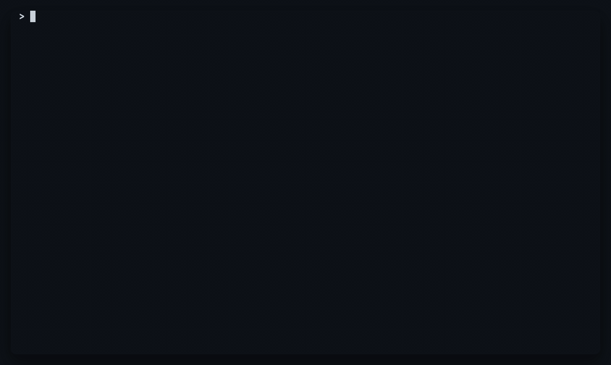
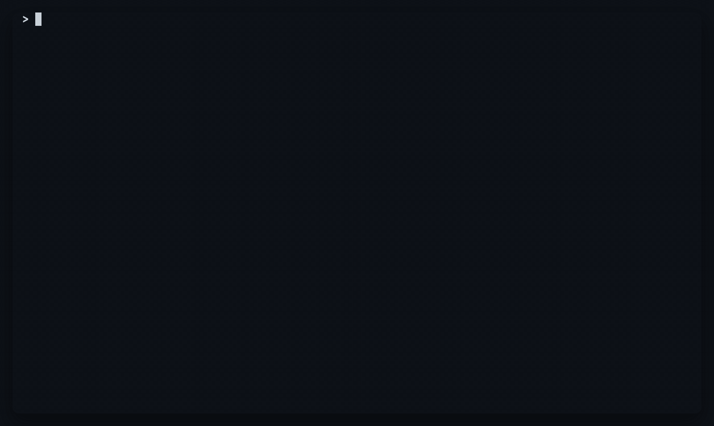
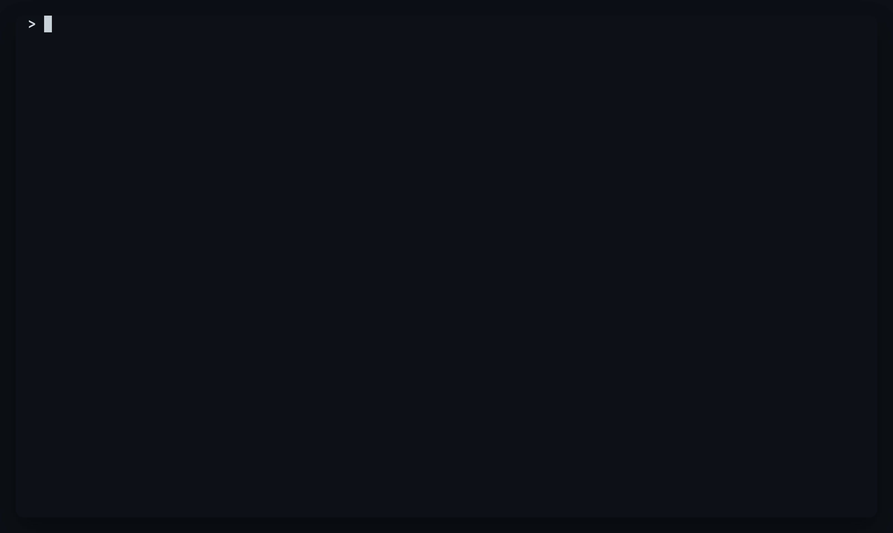
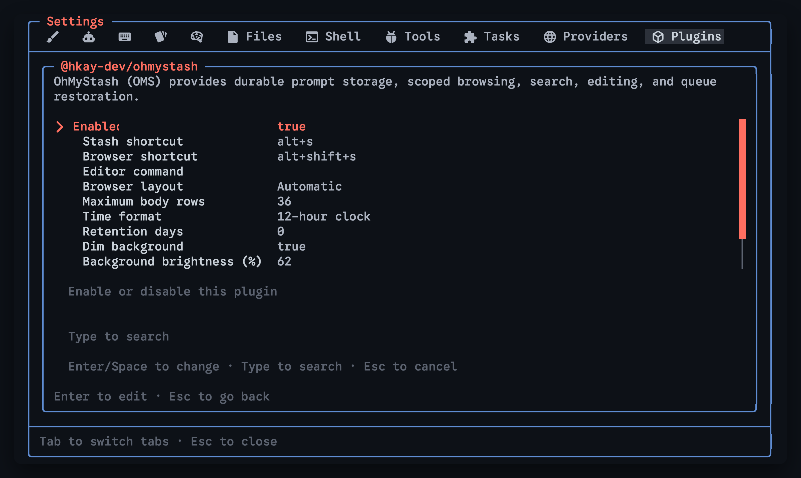

<p align="center">
  
</p>

# OhMyStash for Oh My Pi

I'm proud to present OhMyStash! OMS stores unfinished OhMyPi prompts without submitting them. It preserves normal and `/queue` drafts, images, collapsed large pastes, timestamps, source-chat metadata, locks, and a whole lot more!

> **Validation note:** The new permission-worker changes were tested on Windows. Native macOS testing is still needed for this update. Simulated POSIX checks do not establish native Mac compatibility.


I had a ton of fun making this, and I hope you find it just as useful as I do!

## Install

You need OMP 18.10.4 or newer. OMP's plugin manager installs packages with Bun, so `bun` has to be on your PATH. On macOS:

```sh
brew install bun
```

On Linux and Windows, follow the install steps at [bun.sh](https://bun.sh).

Install directly from GitHub:

```sh
omp plugin install github:hkay-dev/OhMyStash
```

OMP installs the standard SDK dependencies for you, so there's no custom OMP build or separate installer. To pin this release, use `github:hkay-dev/OhMyStash#v1.12.0` instead.

Restart OMP, then open the browser with `Alt+Shift+S` or `/stash`.

To update an existing installation:

```sh
omp plugin install --force github:hkay-dev/OhMyStash
```

Check the installed package and extension manifest with:

```sh
omp plugin doctor @hkay-dev/ohmystash
```

OMP uses the package ID `@hkay-dev/ohmystash` for plugin settings and diagnostics. Existing stash storage paths don't change.

## Primary Usage

### `Alt+S`: stash and restore one prompt

Press `Alt+S` while the composer contains a prompt to stash it immediately. The composer clears so you can move to something else.

Press `Alt+S` on an empty composer to restore the newest stash from the current chat. The stash stays saved after it's restored. If you stash that same draft again, OMS keeps the one stash instead of adding a copy.

### `Alt+Shift+S`: open the browser

Press `Alt+Shift+S` to open the full stash browser. The browser supports preview, search, chat scope, queue actions, editing, locking, and deletion.

The browser opens in OMP's stock bottom overlay, like the built-in Switch Model dialog, with square accent-colored borders and the title in the top border. Your draft, caret, undo history, and attachments stay as they were. The contextual Nerd Font glyphs follow **Show icons** and don't touch OMP's global symbol preset. You need a Nerd Font, or a symbols fallback, to see them.

## Browser capabilities

You can do quite a bit more in the browser:

- **Chat scope.** Open stashes from the current chat and press `g` to switch to all chats.
- **Source metadata.** Global entries show the source chat, workspace, timestamp, and short session ID.
- **Search.** Filter prompt text, chat names, workspaces, timestamps, queue mode, locks, and attachments.
- **Queue draft.** Press `q` to place the selected stash in the composer as an editable `/queue` draft.
- **Submit queue.** Press `Shift+Q` to prepend `/queue ` and submit the selected stash while keeping the browser open for more.
- **Pop.** Press `p` to restore the selected stash and delete it in one go. A locked stash stays.
- **Attachments.** Restore images and collapsed large pastes with the prompt that owns them.
- **Editing.** Press `e` to edit a stash with the configured editor or OMP's built-in editor.
- **Locking.** Lock reusable stashes so deletion leaves them alone.
- **Scoped deletion.** Delete one unlocked stash or clear unlocked stashes from the current browser scope.

After an action, the browser reopens on the stash you were on, or on the same row once that stash is gone. If another OMP session changed a stash while your browser was open, OMS tells you, reloads, and leaves the other session's change alone.

## More Features!

### Current chat and all chats

The browser starts on the current chat. Pressing `g` switches to all chats, back to the current chat, and back to all chats again.


### Queue draft

Regular `q` comes first. It puts the stash into the composer as an editable `/queue` draft.


### Submit queue

`Shift+Q` prepends `/queue `, submits the stash immediately, and keeps the browser open on the same stash. Repeat it to stack messages in OMP's queue, then press `Esc` to exit.

Stash or clear any draft in the composer before restoring or submitting a saved prompt. This includes drafts that contain only images.


### Search

Press `/` and type. Search narrows the current scope as you go. While you're typing, every letter goes into the search, `q` and `Q` included. Press `Enter` to restore the selected match, or `Tab` to keep the filter and get the letter keys back for queueing, popping, editing, locking, and deleting.



### Attachments

Images and large pasted bodies return with their stash. If a stored image or paste is damaged or missing, OMS still restores the rest of the prompt and tells you which attachment it couldn't bring back.



### Editing

Search for a stash, select it, and press `e` to edit it.


### Locking and deletion

Locked stashes remain protected during bulk deletion.



## Controls

| Action | Default control |
| --- | --- |
| Stash the composer, or restore the newest stash from this chat when empty | `Alt+S` |
| Open the stash browser | `Alt+Shift+S` |
| Open the browser from the composer | `/stash` |
| Restore the newest stash from this chat | `/stash restore` |
| Switch between This chat and All chats | `g` |
| Start search | `/` |
| Leave the search, keep its filter, and use the letter keys | `Tab` |
| Restore the selected stash | `Enter` |
| Insert an editable queue draft | `q` |
| Prepend `/queue ` and submit the selected stash | `Shift+Q` |
| Restore the selected stash and delete it, unless it's locked | `p` |
| Edit the selected stash | `e` |
| Lock or unlock the selected stash | `l` |
| Delete the selected unlocked stash | `d` or `Delete` |
| Delete every unlocked stash in the active scope | `Shift+D` |
| Scroll the preview | `[` / `]` |
| Clear search or close | `Esc` |

## Settings

Open `/settings`, choose **Plugins**, select `@hkay-dev/ohmystash`, and press `Enter`.



Available settings:

- **Stash shortcut** and **Browser shortcut**, with `none` to disable either one
- **Editor command**, blank to use `$VISUAL`, `$EDITOR`, or OMP's built-in editor
- **Browser layout**: Automatic, Side by side, Stacked, or Compact
- **Maximum body rows**
- **Time format**: 12-hour or 24-hour
- **Retention days**: `0` keeps stashes indefinitely
- **Show icons**, controlling contextual Nerd Font glyphs in the stash browser

Retention counts from the last time you stashed or restored a prompt, so a stash you keep reusing doesn't expire. It removes only expired, unlocked, normal stashes. Locked stashes, conflict copies, and recovery entries don't expire.

All the same settings are available from the CLI:

```sh
omp plugin config list @hkay-dev/ohmystash
omp plugin config set @hkay-dev/ohmystash "Browser layout" "Stacked"
omp plugin config set @hkay-dev/ohmystash "Retention days" 30
omp plugin config set @hkay-dev/ohmystash "Editor command" "code --wait"
omp plugin config delete @hkay-dev/ohmystash "Browser layout"
```

OMS reloads plugin settings when a new OMP session starts.

## Reliability

I treated failed saves and missing stashes as bugs. OMS uses private atomic writes, file and directory fsync, attachment hashes, recoverable crash-window files, conflict copies, lock protection, and strict file checks.

The regression suite covers interrupted writes, concurrent saves and edits, corrupted attachments, symlinks, permissions, quota contention, recovery files, scoped deletion, source metadata, and retention.

## Performance

I treated noticeable delay after a keypress as a bug. Safety checks stay enabled while OMS avoids repeated parsing, lowercasing, preview construction, attachment writes, and rendering work.

Representative medians:

| Operation | Median |
| --- | ---: |
| Plain stash save into 100 stashes, with the repeat check | 2.382 ms |
| Warm load, 100 entries | 0.995 ms |
| Literal search | 0.00121 ms |
| Fuzzy search | 0.0824 ms |
| Unique 1 MiB attachment write | 1.036 ms |
| Verified 1 MiB attachment reuse | 0.901 ms |
| Verified 1 MiB attachment read | 0.372 ms |
| 1 MiB preview build | 1.315 ms |
| Preview-page extraction | 0.747 ms |
| 1,000 ANSI transformations | 0.226 ms |

Cross-chat benchmark medians:

| Operation | 50 stashes / 10 chats | 256 stashes / 16 chats |
| --- | ---: | ---: |
| Cold load | 2.874 ms | 7.571 ms |
| Warm load | 0.763 ms | 4.150 ms |
| Scope toggle and render | 0.048 ms | 0.045 ms |
| Global literal search and render | 0.086 ms | 0.134 ms |
| Global fuzzy search and render | 0.631 ms | 3.570 ms |
| Split render | 0.016 ms | 0.025 ms |
| Stacked render | 0.015 ms | 0.018 ms |
| Compact render | 0.005 ms | 0.007 ms |

### Optional Windows permission worker

The Windows worker keeps one helper running per OMP session instead of launching PowerShell for each storage action. It reuses the existing ACL validator on every request; it doesn't cache permission grants or disable file fsync. The pipe is private to your Windows account and verifies both endpoint process IDs.

From this checkout or the installed plugin directory, build the optional worker with PowerShell 7:

```powershell
pwsh -NoProfile -File ./extensions/build-storage-worker.ps1
```

From a checkout, `bun run build:windows` runs the same command. The build needs the Windows .NET Framework C# compiler. Start a new OMP session after building. Generated files aren't committed, and the builder refuses to overwrite an existing executable. Stop OMP and move the old generated worker aside before rebuilding.

Without a built worker, OMS retains its existing PowerShell helper. Set `OMS_ACL_TRANSPORT=oneshot` before starting OMP to select that route even when a worker is present.

The Windows-tested local prototype measured warm saves at 5.68-5.79 ms and restores at 3.03-4.68 ms for small synthetic normal and queue prompts. An immediate first save before background warmup completed took 80.26 ms. Those measurements used OMP 18.11.3 and a local OhMyStash 1.11.0 prototype, not a benchmark of every workload or physical key presses on this newer branch.

**Windows tested; native macOS validation still pending for these changes.** The worker only runs on Windows. The POSIX permission path is unchanged, but simulated Darwin tests aren't native Mac testing.

After installing development dependencies and building the worker, its focused Windows checks are:

```sh
bun test tests/storage-worker.test.ts tests/storage-permissions.test.ts
```

## Storage and limits

Stash files:

```text
~/.omp/agent/prompt-stash/
```

Attachments:

```text
~/.omp/agent/prompt-stash/attachments/
```

Limits:

- 1 MiB inline prompt text
- 64 MiB file-backed prompt body or individual attachment
- 128 MiB total attachments per stash
- 64 attachments per stash
- 2 MiB serialized stash metadata
- 256 normal active stashes
- 16 MiB normal metadata budget
- 1 GiB of attachments across all chats

Conflict copies and complete recovery files load outside the normal count and metadata caps. Attachments are content-addressed, so an image you stash twice is stored once, and the attachment limit counts it once.

OMS cleans up after itself:

- After you delete stashes, or retention removes some, it deletes attachments that no stash file names any more, once they're more than a minute old. A save that runs into the attachment limit cleans up first, too.
- It deletes asset temp files a crash left behind once they're a day old, and damaged recovery files it set aside as `*.orphan` once they're a week old.
- A stash file that isn't valid JSON gets renamed to `*.invalid` once, so it stops warning you and stops counting against the limits. Delete it when you don't need it.

On Windows, the permission helper keeps its compiled checks in the stash folder as `.storage-permissions-<hash>.dll`. It's safe to delete; OMS builds it again.

A separate filesystem backup is still required for hardware failure, filesystem corruption, or machine loss.

## Troubleshooting

Messages that start with `OMS failed:` stopped an action. The others are warnings. Paths below are the default ones; yours may differ.

**`OMS storage directory is shared with other accounts. Run: chmod 700 '~/.omp/agent/prompt-stash'`**
OMS only uses a stash folder that other accounts can't open, and this one lets them in. That usually happens after copying it with `cp -r` or a sync tool. Run the command from the message (it has your full path). The attachment folder gets the same message with its own path.

**`OMS storage directory belongs to another account. Run: sudo chown -R "$(id -un)" '...'`**
The folder was created by another user, for example by running OMP with `sudo` once. The command gives it back to you.

**`OMS storage directory ... is a symbolic link. Replace it with the real directory`**
OMS doesn't follow links for its storage. Move the real folder to that path.

**`OMS storage directory ... must be private to your account (...). Remove other accounts from its Security settings`** (Windows)
Open the folder's Properties, then Security, and leave only your own account. OMS sets up new folders this way by itself.

**`3 OMS stashes are hidden because their files are shared with other accounts. Run: chmod 600 '...'/*.json`**
Those stash files can be read by other accounts, so OMS leaves them out of the browser until you fix them. Run the command from the message. A shared attachment says `OMS attachment is shared with other accounts` with its own `chmod 600` command.

**`2 damaged OMS stash files were set aside in ... with an .invalid or .orphan suffix`**
Those files weren't valid stashes, for example after a disk error or a sync conflict. OMS renamed them once and won't mention them again. Look inside if you want, then delete them.

**`1 OMS stash file in ... couldn't be loaded. It may come from a newer OhMyStash`**
The file is valid JSON, but this version doesn't understand it, so OMS leaves it alone. Update OhMyStash.

**`5 older OMS stashes are hidden because the store is over its limit of 256 stashes or 16 MiB. Delete stashes you don't need to bring them back`**
The browser shows the newest stashes that fit. Delete or pop stashes you no longer need and the older ones come back.

**`OMS storage quota reached across all chats. Open the stash browser and press g to manage it`**
A new stash would go over the 256-stash or 16 MiB limit. Press `g` in the browser to see every chat's stashes and delete the ones you don't need. Locked stashes count too.

**`OMS attachment storage is full (1 GiB across all chats). ...`**
Your stashed images and large pastes add up to 1 GiB. OMS already cleaned up unused attachments before saying this, so delete stashes that carry big attachments. Stashes without new attachments still save.

**`Restored prompt from ..., but couldn't restore Image #2 (damaged)`**
The stored copy of that attachment failed its checks, so OMS restored everything else and left a plain `[Image #2 unavailable]` note where the image was. Stashing the same image again repairs the stored copy. `Shift+Q` puts such a stash in the composer instead of submitting it, so you can look first.

**`That stash changed in another session, so OMS reloaded the browser`**
Another OMP window locked, edited, or deleted that stash after your browser loaded it. Nothing was overwritten. Try again on the reloaded list.

**`Restart OMP once so OhMyStash can attach to the native editor`**
OhMyStash attaches to the composer when a session starts. Restart OMP after installing or updating it.

## Development

Use Bun 1.4.3. Development dependencies pin the official SDK packages to 18.10.4, with `^18.10.4` peers. `bun.lock` records the stock registry graph without custom overrides or local SDK archives.

```sh
bun install --frozen-lockfile --ignore-scripts
bun run check
bun test
bun run benchmark:cross-chat
```

The extension entry point is `extensions/prompt-stash.ts`.

OhMyStash also exports its picker helpers at `@hkay-dev/ohmystash/ui`, so other OMP plugins can draw the same overlay, lists, and key labels. The API is in [docs/ui.md](docs/ui.md). Release packaging and the installed-runtime proof are in [docs/releasing.md](docs/releasing.md).

## Credits

Terminal recordings were captured programmatically with [tcut](https://github.com/AmanVarshney01/tcut).
