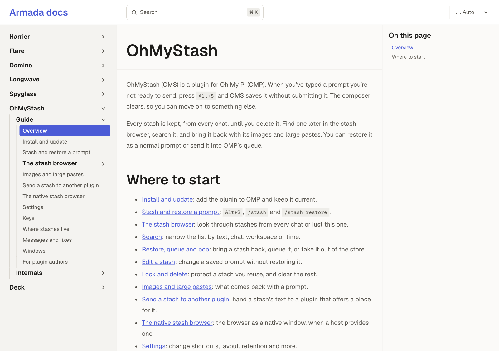

# OhMyStash: OhMyStash's user guide

Changed: OhMyStash has a user guide on Deck's Docs.
Try: Open Docs in Deck and pick OhMyStash; not tried yet.

## News

### A user guide

OhMyStash's guide covers every key, setting and message, from stashing a prompt to the native browser (ohmystash#9v7k)

