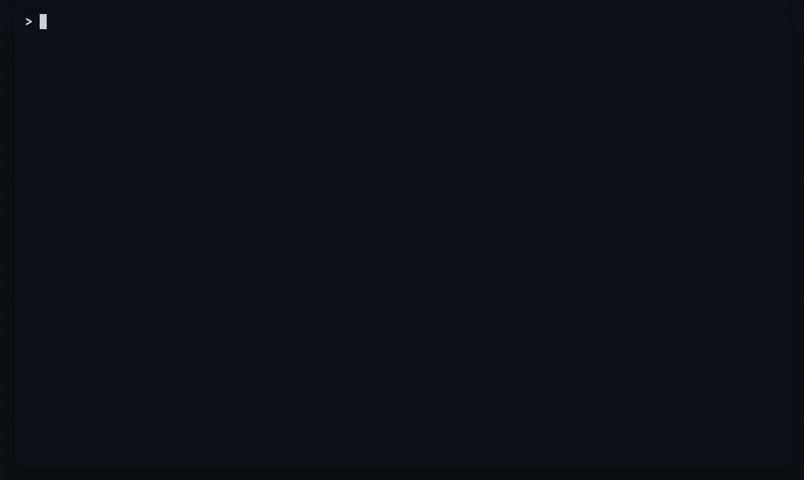

OMP 19.2 lets a plugin read the composer's text only. OMS can store a prompt over 1 MiB and bring it back whole, but it can't read what an image chip or a collapsed-paste chip in the composer stands for.



## What gets saved

- **Very large prompts.** A prompt over 1 MiB is saved as a file, and the list shows `[Large pasted prompt · <lines> lines · <chars> chars]` in its place. Restoring puts the full text back.
- **Images and collapsed pastes.** A draft that holds an image chip or a collapsed-paste chip isn't stashed. OMS says `OMS failed: The draft holds a pasted block or attachment, which OMP doesn't let OhMyStash read. Remove it or send it, then stash again`, and your draft stays as it is.
- **Images from older stashes.** Stashes saved by an earlier version, or by another tool, keep their images in the stash folder. The list shows `+<count>`, and you can search for them (see [search](browser/search.md)).

## Restoring a stash that has images

OMP gives a plugin no way to put an image back in the composer. Restoring puts the stash's text in the composer, with `[Image #1 unavailable]` where each image was, and names the images:

```
Restored prompt from <time>, but couldn't restore Image #1 (OMP doesn't let plugins attach images to the composer)
```

The images stay in the stash. `Shift+Q` still sends them, together with the text, as a queued message. A pop keeps such a stash, so you don't lose the images. See [restore, queue and pop](browser/restore-and-queue.md).

## The same image twice

An image is stored once, however many stashes use it. Stash the same screenshot five times and it takes the room of one, and it counts once against the limits.

## When an attachment is damaged or missing

OMS checks every attachment on the way back. If one is damaged, missing, or readable by other accounts, the rest of the prompt still restores. The text that referred to the bad image shows `[Image #2 unavailable]`, and OMS warns you:

```
Restored prompt from <time>, but couldn't restore Image #2 (damaged)
```

The reason is usually `damaged`, `missing` or `shared with other accounts`. Any other read error, such as a file OMS isn't allowed to open or an attachment folder that isn't private to your account, shows that error's own message as the reason. A large pasted text that can't be read is named `the large pasted text`.

A few things follow:

- A pop keeps the stash when an attachment is missing, so you don't lose the only copy. See [restore, queue and pop](browser/restore-and-queue.md).
- `Shift+Q` doesn't send a prompt that's missing something. It puts the draft in the composer for you to check.

## Limits per stash

One stash can hold up to 64 attachments and 128 MiB of attachments in total, and no single attachment can pass 64 MiB. A stash that goes over is refused with a message saying which limit it hit. The limits across all stashes and the storage folder are on [where stashes live](storage.md).
