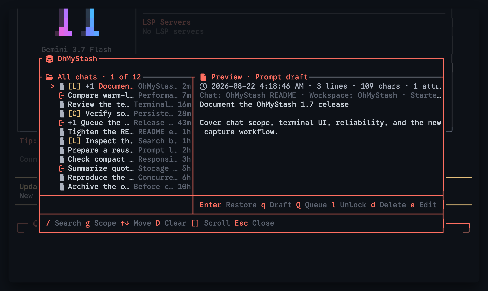
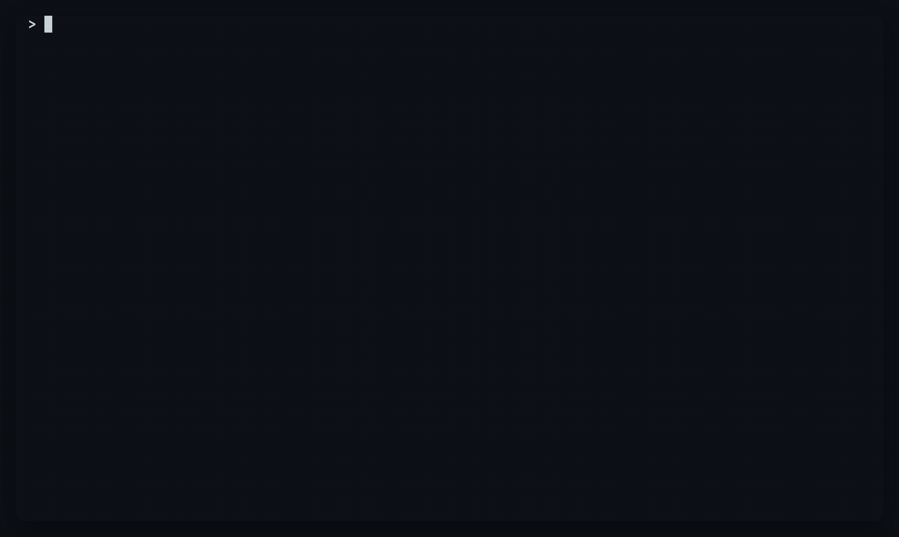

The stash browser is where you look through everything you've stashed, from every chat. You can preview a prompt, search, switch between all chats and this chat, and act on a stash.

## Open the browser

Press `Alt+Shift+S`, or type `/stash` in the composer and press `Enter`. You can change the shortcut in [settings](../settings.md), and the full list of keys is on the [keys](../keys.md) page.

If you have no stashes yet, you see the message `No stashed prompts` and no browser opens.

If OMP runs inside a terminal app that can draw native dialogs, `Alt+Shift+S` opens the browser as a native dialog instead. See [the native stash browser](../native-dialogs.md).

## What the overlay looks like

The browser opens as an overlay at the bottom of OMP, like the built-in Switch Model dialog. It has square accent-colored borders and its title, `OhMyStash`, sits in the top border. Your draft, caret, undo history and attachments in the composer stay as they were while it's open, and closing the browser leaves them alone.

## What each row shows

Each stash is one row, newest first. From left to right a row shows:

- A `>` on the selected row.
- A mark for the kind of stash: a draft mark for a normal prompt, or a queue mark (`[Q]` when icons are off) for a queue draft. A draft shows `[D]` when icons are off.
- `[L]` when the stash is locked. See [lock and delete](lock-and-delete.md).
- `[C]` when the stash is a conflict copy, a copy OMS kept so that an edit made in two sessions at once isn't lost.
- `+2` (or another number) when the stash has attachments.
- The headline: the first line of the prompt that has text in it. A prompt with no text shows `(empty prompt)`.
- On the right, the source chat and the age, such as `now` or `5m`.

The source chat is the chat's name, then ` · ` and the workspace folder it was in. A chat with no name shows `Untitled chat`, the workspace and the first 8 characters of its session id. Stashes from before OMS tracked chats show `Before chat tracking`. The chat column is only there on All chats. On This chat every row is from the same chat, so it's left out.

## The preview

The selected stash shows its full text in a preview next to or below the list. The line above the preview gives the stash's time, its line count, its character count, its attachment count, `locked` and `conflict copy` when they apply, and the rows you're looking at, such as `rows 1-12/40`. The preview title says `Prompt draft` or `Queue draft`.

On All chats, a line also gives the stash's origin: the chat, its workspace, when the chat started and the first 8 characters of its session id.

Long prompts don't fit. Press `]` (or `PageDown`) to scroll the preview down a page and `[` (or `PageUp`) to scroll it back up. Moving to another stash puts the preview back at the top.

## Layouts

The browser has four layouts. Pick one with **Browser layout** in [settings](../settings.md).

- **Automatic** is the default. It uses Side by side when the terminal is at least 92 columns wide and Stacked when it's narrower.
- **Side by side** puts the list on the left and the preview on the right. It needs at least 72 columns.
- **Stacked** puts the list above the preview.
- **Compact** drops the frame and shows a title line, a search line and the preview of the selected stash.

Even when you pick a framed layout, the browser falls back to Compact when the terminal is narrower than 32 columns or too short to fit the frame (fewer than 12 rows for Side by side, 13 for Stacked). **Maximum body rows** in settings caps how tall the framed layouts grow.

## All chats and This chat

The browser opens on **All chats**, so a prompt you started in the wrong chat is right there. Press `g` to switch to **This chat**, which shows only the stashes made in the chat you're in. Press `g` again to go back. The border label always says which one you're on, with your position, such as `All chats · 3 of 12`.

If This chat has no stashes, the browser says `No stashes in this chat` and, when other chats have some, how many (`3 elsewhere · press g` in Compact, `Press g to view all chats` in the framed layouts).

After you act on a stash, the browser reopens on the scope you were using. If you were on This chat, you come back to This chat. Only a fresh opening starts on All chats again.

## Keys in the footer

The footer lists the keys that work right now. Here's what each does and where it's covered.

| Key | What it does |
| --- | --- |
| `/` | Start [search](search.md) |
| `g` | Switch between All chats and This chat |
| `↑` `↓` | Move through the list. `Home` and `End` jump to the first and last stash |
| `[` `]` | Scroll the preview |
| `Enter` | Restore the stash. See [restore, queue and pop](restore-and-queue.md) |
| `q` | Put it in the composer as an editable `/queue` draft. See [restore, queue and pop](restore-and-queue.md) |
| `Q` | Submit it to OMP's queue and keep the browser open. See [restore, queue and pop](restore-and-queue.md) |
| `p` | Pop it. See [restore, queue and pop](restore-and-queue.md) |
| `e` | Edit it. See [edit a stash](editing.md) |
| `l` | Lock or unlock it. See [lock and delete](lock-and-delete.md) |
| `d` | Delete it. See [lock and delete](lock-and-delete.md) |
| `D` | Delete every unlocked stash in the current scope. See [lock and delete](lock-and-delete.md) |
| `s` | Send it to another plugin. It's there when a plugin offers a target: its name when there's one, `Send` when there are several. See [send a stash to another plugin](../send-to-plugins.md) |
| `Esc` | Clear the search if there is one, otherwise close the browser |

`Ctrl+C` closes the browser at any time. `r` also restores, and `Delete` also deletes.

While you're typing in search, only `Enter`, `Tab`, `Esc` and the arrow keys act, because the letters go into the search. See [search](search.md).

On a narrow terminal the footer shortens the `g` label to `Scope`.

## Icons

The browser draws small icons next to its title, its labels and its rows. They come from a Nerd Font, so you need one (or a symbols fallback font) in your terminal to see them. The icons only affect this plugin's pickers and not the rest of OMP.

If you don't have a Nerd Font, turn off **Show icons** in [settings](../settings.md). The browser then uses plain marks: `/` for search, `[D]` for a draft and `[Q]` for a queue draft.

## After an action

Most actions close the browser, do their work and then open it again, so you can keep going. The browser comes back with the same search and the same scope, and with the same stash selected. If that stash is gone (you deleted it or popped it), the selection lands on the row that was in its place.

## When another session changes a stash

You may have more than one OMP session open. If another one changes or removes a stash while your browser is open, and you then act on that stash, OMS stops and shows `That stash changed in another session, so OMS reloaded the browser`. Nothing is overwritten: the action doesn't happen, the browser reloads the stashes from disk, and you can look at what's there now and try again.
